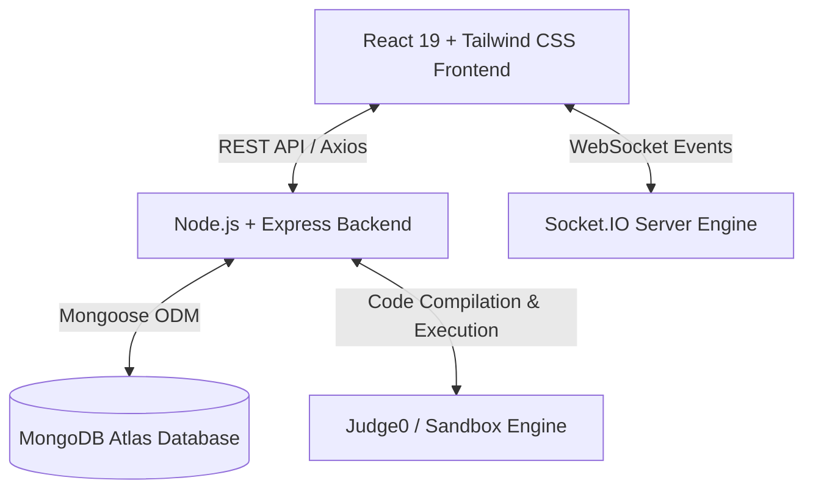

# ⚔️ BATTLIX — Real-Time Competitive Coding & Multiplayer Battle Arena

<div align="center">

**The ultimate multiplayer coding battleground featuring real-time 1v1 duels, automated contest arenas, strict proctoring lockdown, and live execution telemetry.**

[](https://battlix.netlify.app)
[](https://battlix-backend.onrender.com)
[](#license)
[](https://nodejs.org/)
[](https://react.dev/)
[](https://www.mongodb.com/)
[](https://socket.io/)

[🌐 Live Web App](https://battlix.netlify.app) • [🔌 Live Backend API](https://battlix-backend.onrender.com) • [📖 Documentation](#table-of-contents)

</div>

---

## 📌 Table of Contents
- [About BATTLIX](#-about-battlix)
- [Key Features](#-key-features)
  - [1. Real-Time 1v1 Ranked Duels](#1-real-time-1v1-ranked-duels)
  - [2. Multiplayer Contest & Tournament Arenas](#2-multiplayer-contest--tournament-arenas)
  - [3. Enterprise-Grade Anti-Cheat & Proctoring Lockdown](#3-enterprise-grade-anti-cheat--proctoring-lockdown)
  - [4. High-Performance Multi-Language Code Editor](#4-high-performance-multi-language-code-editor)
  - [5. Post-Match Mission Telemetry & Live Code Diffs](#5-post-match-mission-telemetry--live-code-diffs)
  - [6. Daily Blitz Streak & Solo Practice Library](#6-daily-blitz-streak--solo-practice-library)
  - [7. Global Leaderboards & Profile Analytics](#7-global-leaderboards--profile-analytics)
  - [8. Administrative Command Center](#8-administrative-command-center)
- [Architecture & Tech Stack](#-architecture--tech-stack)
- [Screenshots & UI Previews](#-screenshots--ui-previews)
- [Project Directory Structure](#-project-directory-structure)
- [Environment Variables](#-environment-variables)
- [Getting Started Locally](#-getting-started-locally)
- [Controlled Production Deployment](#-controlled-production-deployment)
- [Renaming Repository to Battlix](#-renaming-repository-to-battlix)
- [Contributing & License](#-contributing--license)

---

## 🚀 About BATTLIX

**BATTLIX** is a full-stack, enterprise-grade competitive coding platform designed for programmers, students, and competitive developers who want the intensity of multiplayer gaming combined with algorithmic problem-solving.

Unlike traditional asynchronous coding platforms, BATTLIX introduces **real-time head-to-head combat**. Developers write and execute code simultaneously under strict proctoring lockdown while streaming live solution metrics. Matches conclude the moment a combatant passes all private verification testcases or when time expires, instantly updating Elo ratings, win/loss stats, and solution heatmaps.

---

## ⚡ Key Features

### 1. Real-Time 1v1 Ranked Duels
- **Live Matchmaking Queue:** Algorithmic queue matching combatants based on Elo rating and skill tier.
- **Synchronized Sprints:** Both competitors receive the challenge simultaneously with synchronized timers and instant win detection.
- **Dynamic Elo Rating:** Competitive ranking system updating XP, trophies, and ranked tiers immediately upon match resolution.

### 2. Multiplayer Contest & Tournament Arenas
- **Custom Room Creation:** Host custom private or public rooms with configurable duration, problem difficulty, and participant limits.
- **Solo & Team 2v2 Modes:** Compete as individual gladiators or coordinate in teams with synchronized team scoring.
- **Lobby Synchronization:** Live player slots, ready checks, team assignments, and host controls powered by WebSockets.

### 3. Enterprise-Grade Anti-Cheat & Proctoring Lockdown
- **Mandatory Fullscreen Gateway:** The battle arena strictly enforces fullscreen lockdown before code can be edited or submitted.
- **Tab-Switch & Blur Monitoring:** Automatic tracking of focus loss, window changes, and developer inspection attempts.
- **Clipboard Isolation:** Paste prevention to inhibit copy-pasting from external sources or LLMs.
- **Clean Result Transitions:** Seamless fullscreen release upon match conclusion, victory modal display, and telemetry viewing without jarring false-positive violation alerts.

### 4. High-Performance Multi-Language Code Editor
- **Multi-Language Support:** First-class starter boilerplate and testcase runners for **Python**, **JavaScript**, **C++**, **Java**, and **C**.
- **Caret & Caret Preservation:** Zero cursor jumping or focus loss during background autosave and manual save operations.
- **Custom Testcase Playground:** Execute code against public sample testcases or inject custom inputs with instant stdout/stderr telemetry.

### 5. Post-Match Mission Telemetry & Live Code Diffs
- **Opponent Solution Inspection:** Live code streaming during match playback and post-match side-by-side diff viewers.
- **Detailed Execution Breakdown:** Runtime metrics, memory footprints, and per-testcase pass/fail audits.

### 6. Daily Blitz Streak & Solo Practice Library
- **Curated Problem Archive:** Filter problems by tags (Arrays, DP, Strings, Graphs, Greedy, Math) and difficulty (Easy, Medium, Hard).
- **Daily Blitz Challenges:** Daily timed problem sprints rewarding daily streaks and bonus XP multipliers.

### 7. Global Leaderboards & Profile Analytics
- **Live Leaderboards:** Global standings separated by Ranked 1v1 Elo, Contest Points, and Practice XP.
- **Developer Profiles:** Interactive GitHub/LeetCode-style submission heatmaps, win rates, and battle history.

### 8. Administrative Command Center
- **Problem Authoring Suite:** Create problems with comprehensive descriptions, constraints, examples, and hidden private testcases.
- **Contest Management:** Schedule, pause, cancel, or finalize competitive contest events.
- **User Auditing:** Monitor combatant activity, manage permissions, and inspect anti-cheat infraction logs.

---

## 🛠 Architecture & Tech Stack



### Frontend
- **Framework:** React 19 + Vite 7
- **Styling:** Vanilla CSS + Tailwind CSS 4 with custom dark/light theme engines
- **Icons:** React Icons (`react-icons/fa`, `react-icons/fi`)
- **Networking:** Axios & Socket.IO Client
- **Routing:** React Router v7

### Backend
- **Runtime:** Node.js 20+ (ES Modules)
- **Framework:** Express.js 5
- **Database:** MongoDB Atlas via Mongoose 9
- **Real-Time Communication:** Socket.IO 4
- **Security & Authentication:** JSON Web Tokens (JWT) & bcryptjs
- **Execution & Code Evaluation:** Judge0 RapidAPI / Containerized execution engine

### Hosting & Infrastructure
- **Frontend Deployment:** Netlify (Continuous Deployment via `deploy` branch)
- **Backend Deployment:** Render (Web Service via `deploy` branch)
- **Database Cluster:** MongoDB Atlas

---

## 📸 Screenshots & UI Previews

| Arena Dashboard & 1v1 Queue | High-Performance Code Editor & Telemetry |
| :---: | :---: |
| *(Interactive Cyberpunk Arena Lobby)* | *(Split-Pane Editor with Live Testcase Outputs)* |

| Real-Time Battle Results | Submission Activity Heatmap |
| :---: | :---: |
| *(Victory & Mission Telemetry Summary)* | *(Submission Heatmap & Elo Progress Tracker)* |

> *(Place your custom screenshots inside `frontend/public/` or link your cloud-hosted images here)*

---

## 📁 Project Directory Structure

```plaintext
Code_Game/
├── backend/
│   ├── config/              # Database & environment configurations
│   ├── controllers/         # Battle, contest, user, and problem controllers
│   ├── middleware/          # JWT auth & admin guard middleware
│   ├── models/              # Mongoose schemas (User, Problem, Battle, Contest)
│   ├── routes/              # Express API route endpoints
│   ├── utils/               # Judge0 API execution helpers & scoring utilities
│   ├── server.js            # Main backend server entry point & WebSocket handlers
│   └── package.json
├── frontend/
│   ├── public/              # Static public assets (logo.jpg, coding.mp4, etc.)
│   ├── src/
│   │   ├── Admin/           # Admin portal (CreateProblem, AdminProblems, AdminUsers)
│   │   ├── Components/      # Reusable UI (CodeEditor, ProctoringGuard, Heatmaps)
│   │   ├── Pages/           # Primary views (Home, ContestPage, ProblemSolve, ResultPage)
│   │   ├── utils/           # Editor indentation & selection helpers
│   │   ├── App.jsx          # Route definitions & app providers
│   │   └── main.jsx         # React application bootstrap
│   ├── .env.production      # Production environment configuration
│   ├── vite.config.js       # Vite build configuration
│   └── package.json
├── deploy.ps1               # Controlled deployment script (syncs to 'deploy' branch)
├── deploy.bat               # Windows batch shortcut for deploy.ps1
├── start-dev.ps1            # PowerShell launcher for local development servers
├── start-dev.bat            # Windows batch launcher for local development servers
├── netlify.toml             # Netlify frontend build & redirect rules
├── render.yaml              # Render backend service specification
└── package.json             # Root package manager & concurrently scripts
```

---

## 🔑 Environment Variables

### Backend Configuration (`backend/.env`)
Create a `.env` file in the `backend/` directory:

```env
PORT=5000
NODE_ENV=development
MONGO_URI=mongodb+srv://<username>:<password>@cluster0.mongodb.net/Code_Game?retryWrites=true&w=majority
JWT_SECRET=your_jwt_secret_key_here
JWT_SECRET_ADMIN=your_admin_secret_key_here
ADMIN_USERNAME=admin_username
ADMIN_PASSWORD=admin_password
CLIENT_URL=http://localhost:5173
```

### Frontend Configuration (`frontend/.env`)
Create a `.env` file in the `frontend/` directory for local development:

```env
VITE_API_URL=http://localhost:5000
```

For production builds, `frontend/.env.production` is automatically loaded:
```env
VITE_API_URL=https://battlix-backend.onrender.com
```

---

## 💻 Getting Started Locally

### Prerequisites
- **Node.js** >= 18.x
- **npm** >= 9.x
- **MongoDB** instance (local or free MongoDB Atlas cluster)

### Installation

1. **Clone the repository:**
   ```bash
   git clone https://github.com/muthukumar9360/Code_Game.git
   cd Code_Game
   ```

2. **Install root, backend, and frontend dependencies:**
   ```bash
   npm install
   npm install --prefix backend
   npm install --prefix frontend
   ```

3. **Configure Environment Variables:**
   Populate `backend/.env` and `frontend/.env` as described above.

4. **Seed Initial Coding Problems (Optional):**
   ```bash
   npm run seed --prefix backend
   ```

5. **Start Development Servers:**
   - **Using npm script:**
     ```bash
     npm run dev
     ```
   - **Using Windows PowerShell launcher:**
     ```powershell
     .\start-dev.ps1
     ```
   - **Using Windows Batch launcher:**
     ```cmd
     start-dev.bat
     ```

6. **Access the application:**
   - **Frontend:** [http://localhost:5173](http://localhost:5173)
   - **Backend API:** [http://localhost:5000](http://localhost:5000)

---

## 🚀 Controlled Production Deployment

To prevent burning Render and Netlify monthly build minutes during rapid local development, this repository uses a **Controlled Deployment Pipeline** via the `deploy` branch:

- Everyday development commits stay on the `main` branch.
- When ready to publish a production update, run:

```powershell
powershell -ExecutionPolicy Bypass -File .\deploy.ps1 -Message "feat: your production release message"
```

The script automatically:
1. Stages and commits all working files to `main`.
2. Pushes `main` to GitHub.
3. Synchronizes and force-pushes the exact state to the `deploy` branch.
4. Triggers automatic builds on Netlify (Frontend) and Render (Backend).
5. Switches your local branch back to `main` so you can continue coding without interruption.

---

## 🔄 Renaming Repository to Battlix

If you wish to rename the GitHub repository from `Code_Game` to `Battlix`:

1. **On GitHub:**
   - Go to your repository on GitHub: `https://github.com/muthukumar9360/Code_Game`
   - Click **Settings** (⚙️ tab).
   - Under **Repository name**, change `Code_Game` to `Battlix` (or `battlix`).
   - Click **Rename**.

2. **GitHub Automatic Redirects:**
   - GitHub automatically maintains redirects for web links, clones, and pushes from `muthukumar9360/Code_Game` to `muthukumar9360/Battlix`.

3. **Update Local Git Remote:**
   Run this command in your local terminal:
   ```bash
   git remote set-url origin https://github.com/muthukumar9360/Battlix.git
   ```
   Verify with:
   ```bash
   git remote -v
   ```

4. **Netlify & Render:**
   - Because Netlify and Render are connected via GitHub OAuth, they automatically update to the new repository name. Verify the repository link in your Netlify and Render project settings.

---

## 📄 Contributing & License

Contributions, issues, and feature requests are welcome!

1. Fork the Project
2. Create your Feature Branch (`git checkout -b feature/AmazingFeature`)
3. Commit your Changes (`git commit -m 'Add some AmazingFeature'`)
4. Push to the Branch (`git push origin feature/AmazingFeature`)
5. Open a Pull Request

Distributed under the **MIT License**. See `LICENSE` for more information.

---

<div align="center">

**Built with passion for competitive programmers worldwide.**  
© 2026 BATTLIX. All Rights Reserved.

</div>
